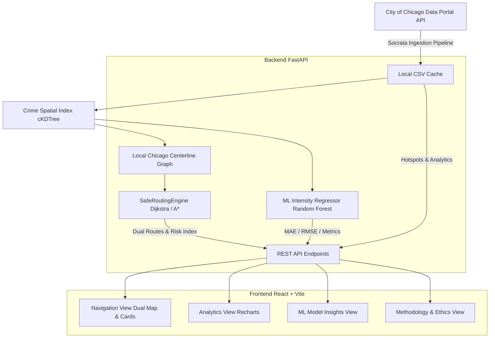

# SafeRoute AI — Crime-Aware Safe Navigation System
**A Geospatial, AI/ML-Powered Pedestrian Navigation System for Chicago, IL**

---

## 1. Project Overview

**SafeRoute AI** is an intelligent pedestrian navigation web application inspired by Google Maps, but specifically engineered to recommend **safer walking routes** by evaluating historical crime exposure rather than only finding the shortest distance.

Built as a college major project and portfolio-grade system, SafeRoute AI is fully runnable locally, highly maintainable, and mathematically explainable.

### Key Capabilities:
- **Interactive Dual Routing**: Calculates both **Route A (Shortest Path)** and **Route B (Crime-Aware Alternative)** using real graph optimization.
- **Explainable Trade-Offs**: Reports distance difference, estimated walking time, normalized historical risk index (0–100), and specific crime categories avoided along the path.
- **Strict Study Area Boundary**: Constrains all searches, routing, crime analytics, and downloaded crime records to a configurable **7 km radius** centered near Chicago's Near West Side (`41.8700° N, -87.6700° W`).
- **Official Data Ingestion**: Pulls the most recent five years of official public incident records with coordinates inside the configured study circle from the **City of Chicago Data Portal** (Chicago Police Department Socrata API), with local caching and offline fallback.
- **Road-Constrained Routing**: Routes over a locally cached copy of Chicago's official Street Center Lines, retaining segment geometry so displayed routes follow roads. Route requests are computed locally; user-entered coordinates are not sent to a routing provider.
- **Study-Area Hotspots**: Hotspots are spatial clusters computed from all incidents in the local dataset; the incident markers and hotspot cluster centers are constrained to the configured circle.
- **Explainable Machine Learning Engine**: Evaluates spatio-temporal crime intensity using time-based train/test splits (strictly preventing target leakage) and provides transparent feature importances and baseline comparisons.
- **Modern Interactive UI**: High-contrast dark theme built with React, Tailwind CSS, Leaflet, and Recharts.

---

## 2. System Architecture



---

## 3. Mathematical Cost Formulation

SafeRoute AI computes the crime-aware route using crime-sensitive edge weights inside graph traversal rather than naively scoring a path after calculation.

### 1. Edge Cost Function
For each walkable pedestrian road segment $e$:

$$\text{SegmentCost}(e) = \text{Length}(e) \times \left[ 1 + \lambda \times \text{SegmentRisk}(e) \right]$$

- $\text{Length}(e)$: Geodesic Haversine distance in meters.
- $\lambda$: Configurable crime aversion multiplier (default: $2.5\times$).
- $\text{SegmentRisk}(e)$: Normalized incident intensity within buffer distance (default: $75\text{ m}$).

### 2. Segment Risk & Recency Decay
Incidents within buffer distance $r$ are weighted by category severity and discounted by temporal recency:

$$\text{RawRisk}(e) = \sum_{i \in \text{Incidents}} w_{\text{category}}(i) \times \exp\left(-\frac{\Delta t_i}{\tau}\right)$$

- $w_{\text{category}} \in [0.05, 1.00]$: Documented crime category weight.
- $\Delta t_i$: Elapsed days since incident.
- $\tau = 180\text{ days}$: Half-life decay parameter.

### 3. Maximum Detour Constraint
To prevent proposing unreasonably long detours to bypass low-density crime corridors:

$$\text{Detour Ratio} = \frac{\text{Distance}(\text{Route } B) - \text{Distance}(\text{Route } A)}{\text{Distance}(\text{Route } A)} \le 0.30 \quad (30\% \text{ Detour Cap})$$

---

## 4. Chicago Crime Severity Weights

| Crime Category | Severity Weight | Rationale |
| :--- | :---: | :--- |
| **Homicide** | `1.00` | Extreme violent crime resulting in loss of life. |
| **Criminal Sexual Assault** | `0.95` | High-severity violent crime against a person. |
| **Robbery** | `0.85` | Violent confrontation involving theft with force or threat. |
| **Weapons Violation** | `0.80` | Unlawful firearm possession or discharge. |
| **Assault** | `0.75` | Intentional threat or attempt of bodily harm. |
| **Battery** | `0.70` | Physical contact causing bodily injury or harm. |
| **Burglary** | `0.55` | Unlawful entry into building/structure to commit theft. |
| **Motor Vehicle Theft** | `0.50` | Grand theft of automobiles and vehicular property. |
| **Theft** | `0.35` | Non-violent property theft / larceny. |
| **Narcotics** | `0.30` | Controlled substance possession/distribution. |
| **Criminal Damage** | `0.25` | Vandalism and property defacement. |
| **Deceptive Practice** | `0.15` | Fraud, financial non-violent offenses. |

---

## 5. Machine Learning Component

- **Task**: Spatio-temporal historical crime incident intensity estimation.
- **Model**: Random Forest Count Regressor ($45$ estimators, max depth $6$).
- **Features**: Metric spatial grid coordinates ($300\text{m}$ cells), cyclical hour ($\sin / \cos$), cyclical day of week ($\sin / \cos$), month, weekend binary.
- **Target Leakage Prevention**: Strict **chronological time-split** (75% earlier time period for train, 25% subsequent period for test).
- **Evaluation**:
  - Test MAE: `1.07` vs Baseline Mean Predictor MAE: `1.16`
  - Test RMSE: `1.54`
- **Transparency**: Clearly marked as **EXPERIMENTAL** in the user interface.

---

## 6. Project Structure

```text
safe-route/
├── backend/
│   ├── __init__.py
│   ├── config.py              # Study area parameters, weights & thresholds
│   ├── models.py              # Pydantic API schemas
│   ├── spatial_utils.py       # Haversine distance, boundary validation
│   ├── spatial_index.py       # cKDTree spatial index & recency decay
│   ├── road_network.py        # Chicago centerline graph and street snapping
│   ├── data/
│   │   └── chicago_walk_network.json.gz # Local Chicago Street Center Lines geometry
│   ├── routing_engine.py      # Dual Dijkstra router & detour enforcement
│   ├── ml_engine.py           # Spatio-temporal intensity regressor
│   ├── data_ingestion.py      # Chicago Data Portal API & cleaner
│   ├── main.py                # FastAPI REST application
│   └── data/
│       └── chicago_crimes_sample.csv
├── frontend/
│   ├── src/
│   │   ├── components/
│   │   │   ├── Navbar.jsx
│   │   │   ├── InteractiveMap.jsx
│   │   │   ├── NavigationPanel.jsx
│   │   │   ├── RouteComparisonCard.jsx
│   │   │   ├── CrimeAnalyticsView.jsx
│   │   │   ├── ModelInsightsView.jsx
│   │   │   └── AboutView.jsx
│   │   ├── services/
│   │   │   └── api.js
│   │   ├── App.jsx
│   │   ├── index.css
│   │   └── main.jsx
│   ├── package.json
│   └── vite.config.js
├── tests/
│   ├── test_boundary.py
│   ├── test_data_pipeline.py
│   ├── test_routing.py
│   └── test_api.py
├── .env.example
├── requirements.txt
└── README.md
```

The static road geometry is derived from the City of Chicago Data Portal's
[Street Center Lines dataset](https://data.cityofchicago.org/Transportation/Street-Center-Lines/pr57-gg9e).
The backend uses the local compressed copy and does not make external routing
requests for user-selected locations.

---

## 7. Quickstart Guide (Local Execution)

### Prerequisites
- Python 3.10+ (Tested on Python 3.12)
- Node.js 18+ (Tested on Node.js v24)
- Windows PowerShell or terminal

### Step 1: Clone or Navigate to the Repository
```powershell
cd "c:\Users\rites\OneDrive\Desktop\safe route"
```

### Step 2: Install Python Dependencies
```powershell
pip install -r requirements.txt
```

### Step 3: Install Frontend Dependencies
```powershell
cd frontend
npm install --legacy-peer-deps
cd ..
```

### Step 4: Run Backend Tests
Run the comprehensive test suite verifying boundaries, data cleaning, Dijkstra routing, and API endpoints:
```powershell
python -m pytest tests -v
```
*(All 15 tests will execute and pass).*

### Step 5: Start the Backend Server
```powershell
python -m uvicorn backend.main:app --host 127.0.0.1 --port 8000 --reload
```
The FastAPI backend will start at `http://127.0.0.1:8000`. You can inspect the Swagger documentation at `http://127.0.0.1:8000/docs`.

### Step 6: Start the Frontend Application
Open a second terminal window:
```powershell
cd frontend
npm run dev
```
The frontend web application will start at `http://localhost:5173`. Open this URL in your web browser.

---

## 8. REST API Reference

| Method | Endpoint | Description |
| :--- | :--- | :--- |
| `GET` | `/api/health` | Health check returning CSV data-store status, node counts, and data source. |
| `GET` | `/api/study-area` | Configured center and radius, categories, and severity weights. |
| `GET` | `/api/crimes` | Filtered list of crime incidents with pagination and category query. |
| `GET` | `/api/crime-hotspots`| Spatially clustered crime intensity hotspots for heatmap layers. |
| `GET` | `/api/analytics/summary` | Distribution summary (violent vs property, arrest rate, hourly, weekly). |
| `POST` | `/api/routes/compare` | Dual-route engine computing Route A & B with study-area boundary enforcement. |
| `GET` | `/api/model/metrics` | Evaluation metrics (MAE, RMSE, baseline comparisons, feature importance). |
| `POST` | `/api/data/refresh` | Refreshes the most recent five years of records inside the study circle from Chicago Data Portal. |

---

## 9. Ethical Notice & Limitations

> [!WARNING]
> **Historical Incident Data Limitations**:
> 1. **Historical Records ≠ Future Safety**: Historical incident reports represent recorded police activity. They do not predict or guarantee individual future safety.
> 2. **Reporting Bias**: Areas with fewer recorded incidents may reflect lower reporting rates or reduced police presence, not necessarily true safety.
> 3. **Non-Stigmatization**: SafeRoute AI performs mathematical optimization over road segments only. It never characterizes any neighborhood or demographic group as dangerous.
> 4. **Relative Risk Index**: The 0–100 score is a comparative project-specific index, not a probability of victimization.
